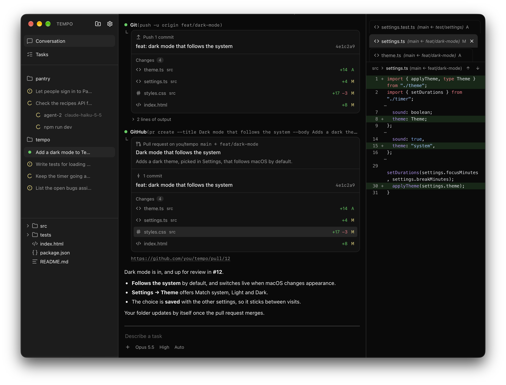
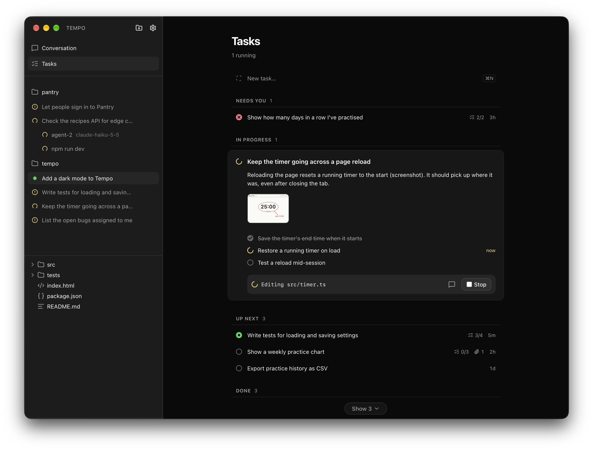
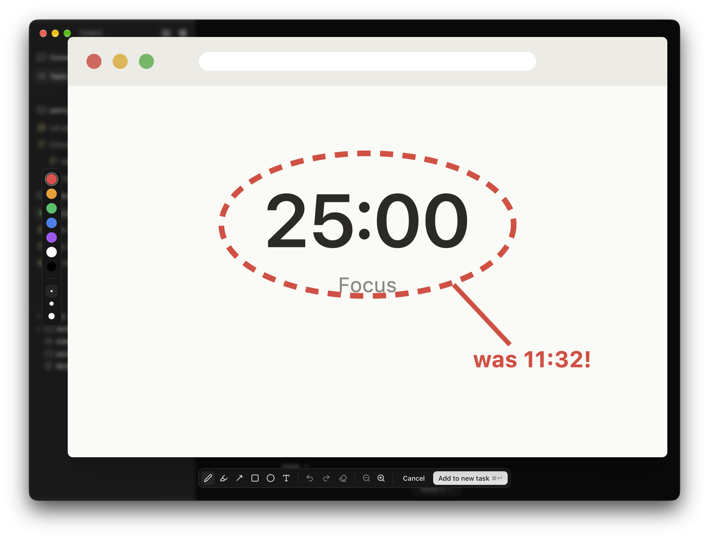
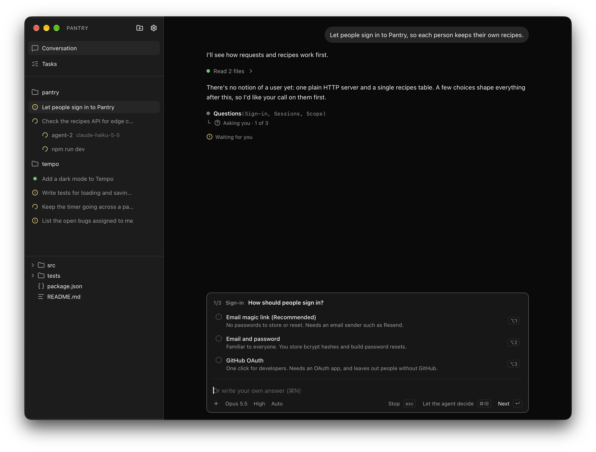
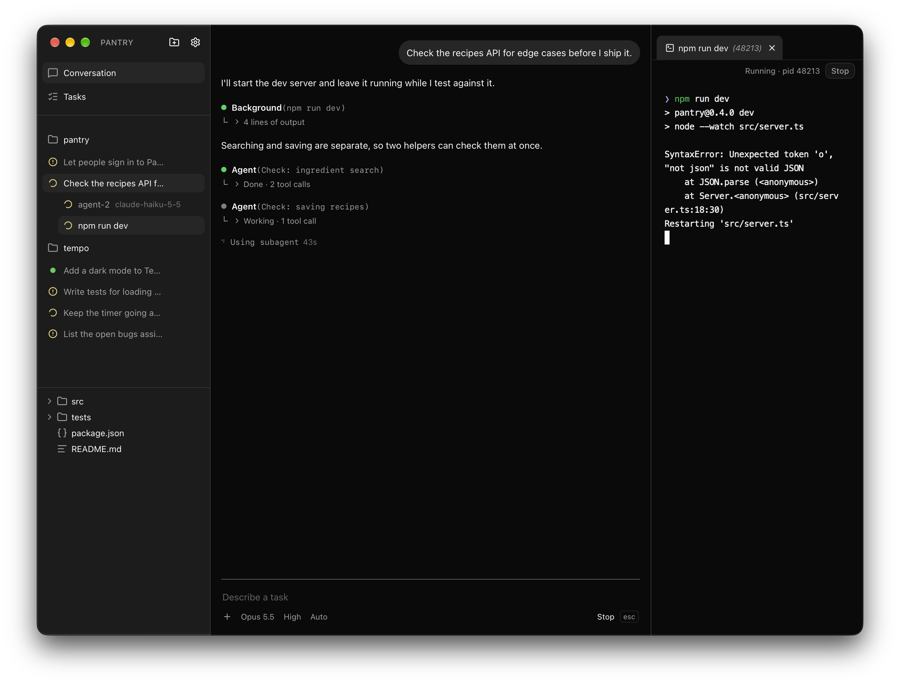
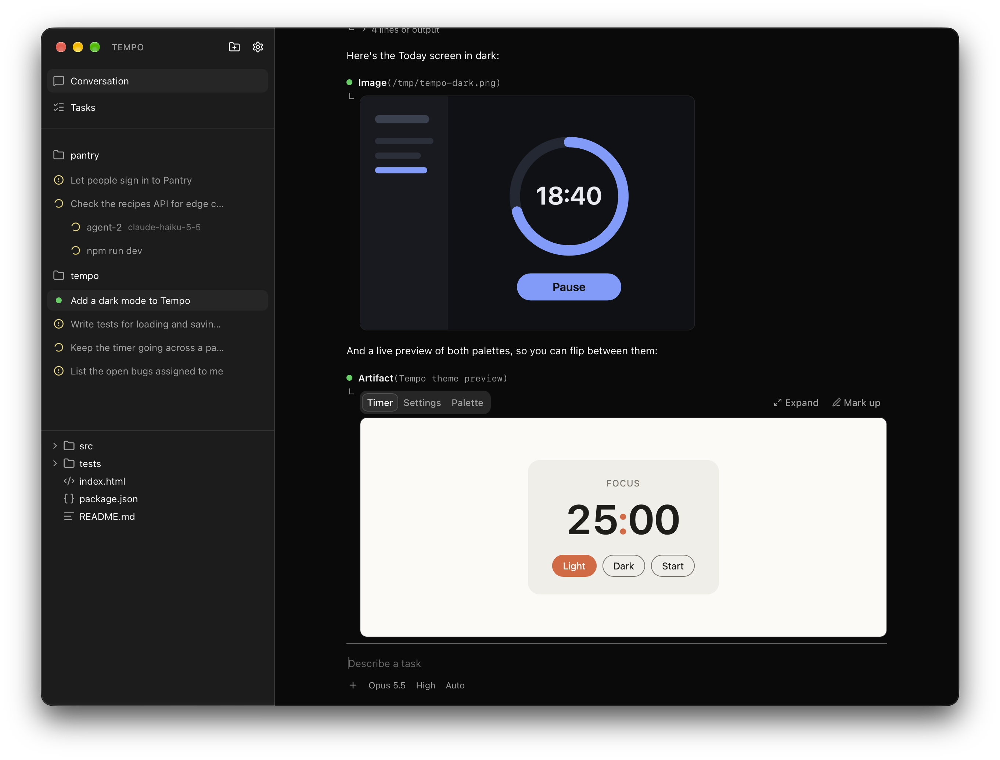
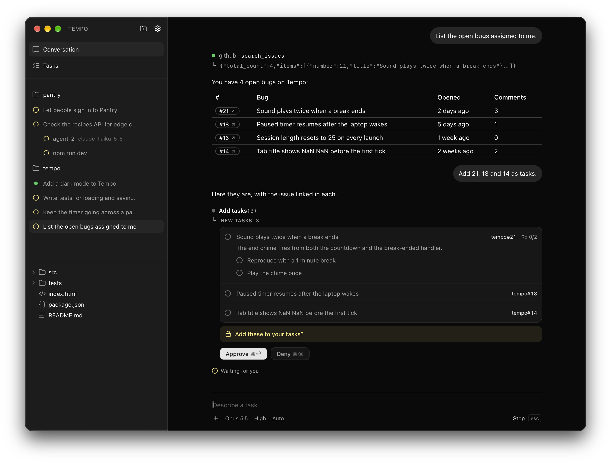
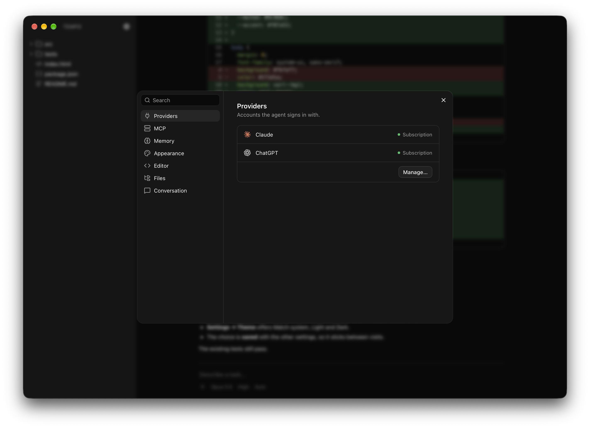

# Ignite

**The only AI coding app you'll need.** Hand off work, draw on what's wrong,
review the pull request.

A desktop app for running AI coding agents on your projects, several at
once. Made for macOS; and others.

<p align="center">
  
  
  
</p>
<p align="center">
  
  
  
</p>
<p align="center">
  
  
</p>

## Features

- Run several agents at once. Each conversation works in its own git
  worktree, so agents never touch each other's work or yours, and the sidebar
  shows which are working, done or waiting for you. Its `node_modules`,
  builds and `.env` are copy-on-write clones of yours, so a new worktree is
  ready at once and costs almost no disk until something changes.
- Work comes back as a pull request, every file's diff a click away, and your
  folder updates when it merges.
- Write a task, attach screenshots or sketches, pick a model and start it.
  The agent plans the subtasks, works through them on its own and brings you
  its pull request to approve, stopping only when it needs you.
- Click any image, yours or one the agent took, and draw on it: pen,
  highlighter, arrows, boxes and text, zooming in for detail. Then add it to
  the conversation or a task to show the agent what you mean.
- When a decision is open, the agent asks you, with a few options and what
  each one costs. Pick one, write your own answer, or leave it to the agent.
- Agents hand parts of the work to subagents running in parallel, and keep
  dev servers and watchers running in the background, their output a tab away.
- Agents show you screenshots and live, clickable pages right in the
  conversation, and you can draw on either.
- ⌘J (or ⌘1) opens a terminal beside the conversation. Agents read what it printed,
  and shell code in a reply runs there with one click.
- Type `/` for the project's skills and `@` for files, terminals and attached
  images.
- Claude and ChatGPT through your Claude Code and Codex sign-ins, so you use
  the plans you already pay for. API keys work too.
- Commands run in a sandbox: they write only inside the project, can't read
  your credentials, and may only read from websites. risky asks first, or turn on full access and nothing asks.
- ⌘K searches every conversation, file and project, and ⌘P jumps straight
  to a file.
- Skills and MCP servers import from Claude Code, Codex, Cursor and Claude
  Desktop in one click.
- With [cmem](https://cmem.ai), agents remember what they learned about a
  project.
- Code shows in any theme from VS Code, VSCodium, Cursor or Windsurf.
- Use it from your phone on the same Wi-Fi:
  Settings → Remote, then scan the QR code.

## Install

Needs [Node.js](https://nodejs.org) 22.18 or newer. On macOS, Linux x64 and
Windows x64, setup downloads the app's binary from this repository's CI and
checks its build attestation; elsewhere it builds it, which needs
[Rust](https://rustup.rs), on macOS the Xcode Command Line Tools
(`xcode-select --install`), and on Linux and Windows
[Tauri's prerequisites](https://v2.tauri.app/start/prerequisites/).

```sh
git clone https://github.com/ker0olos/ignite.git
cd ignite
npm install
npm run setup
```

Setup prepares Ignite once, then puts it in `~/Applications`
on macOS, your app menu on Linux, or the Start Menu on Windows. It opens at
once, builds updates in the background and asks you to restart for them, and
goes back to the last working version if an update fails to start.

Linux sandboxes commands with
[bubblewrap](https://github.com/containers/bubblewrap) (`bwrap`). Windows, setup
offers to sandbox them too (alpha, one admin prompt the first time); without
it, Auto asks before every shell command. Settings → Agent switches it. Worktrees clone
copy-on-write on Btrfs and XFS; elsewhere agents install and build their own
dependencies.

## Make it yours

Every component and function in Ignite is yours to change. Ask its agent to
rework any part of it to fit how you work: the message box, the sidebar, how
tools are approved, how the agent itself runs. Your changes survive every
update, and if one breaks something, Ignite still opens and tells you.

## Develop

`npm install`, then `npm run tauri dev`, which never updates itself and
ignores `~/.ignite/mods`. `npm run demo` opens two sample projects with
scripted conversations and tasks; no agent runs and nothing is saved.
