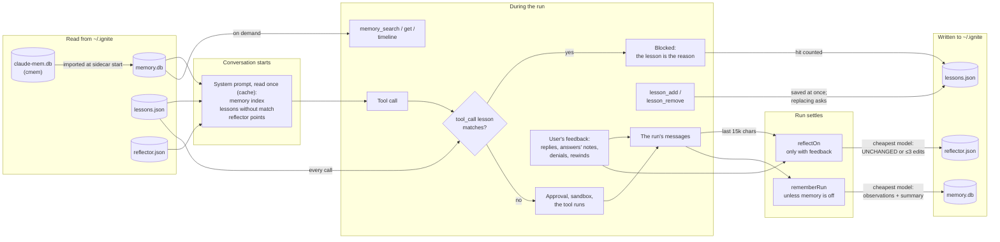
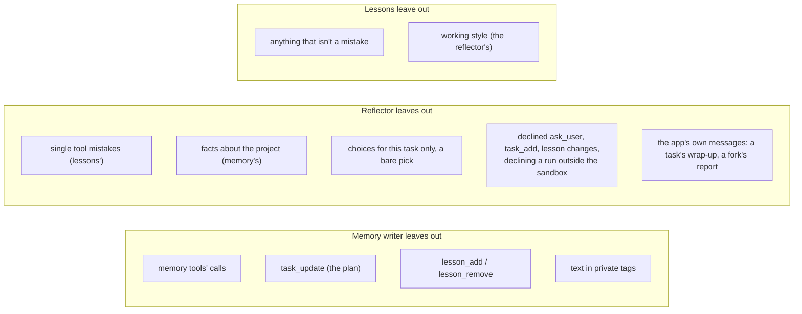

# How the agent learns: memory, lessons and the reflector

Three systems carry what one conversation learned into later ones. Each has
one job, and each leaves the others' jobs alone.

|                   | Memory                                                                              | Lessons                                                                        | Reflector                                                                   |
| ----------------- | ----------------------------------------------------------------------------------- | ------------------------------------------------------------------------------ | --------------------------------------------------------------------------- |
| Keeps             | What the work was: observations (bugfix, feature, decision…) and each run's summary | The agent's mistakes, so none repeats                                          | How this user wants the agent to work: report, ask, plan, deliver, delegate |
| Written by        | The cheapest model of the conversation's provider, after every run                  | The agent itself, with `lesson_add`, the turn it's corrected                   | The cheapest model, after a run with the user's feedback                    |
| Stored in         | `~/.ignite/memory.db` (SQLite, FTS5), per folder                                    | `~/.ignite/lessons.json`, every folder or one                                  | `~/.ignite/reflector.json`, every folder                                    |
| Read by the agent | An index in the system prompt; `memory_search`, `memory_get`, `memory_timeline`     | Listed in the system prompt; a `tool_call` lesson with `match` blocks the call | Each point beside its entry point's guidance in the system prompt           |
| Limits            | Index: 50 observations, 10 summaries, 10,000 characters                             | 30 per scope                                                                   | 10 per entry point, 3 edits per reflection                                  |
| Subagents         | None                                                                                | The same checks                                                                | None                                                                        |
| Code              | `hostMemory.ts`, `memoryWriter.ts`, `memoryContext.ts`, `memoryExtension.ts`        | `lessonExtension.ts`, `lessons.ts`, `lessonRegex.ts`                           | `hostReflect.ts`, `reflector.ts`, `reflectorExtension.ts`                   |

## Through one conversation

Each file shows twice: on the left where it's read, on the right where it's
written.

The system prompt is read once per conversation, so what a run writes reaches
the next conversation, not the rest of this one. Lessons are the exception:
their `tool_call` checks read `lessons.json` on every call, so a lesson saved
mid-run blocks its mistake at once.

## What each leaves to the others

- **A mistake** the user corrects becomes a lesson, written by the agent in the
  same turn. The reflector skips it: one tool mistake teaches nothing about how
  the user wants the agent to work.
- **A working style** ("ask one decision per question") comes only from the
  user's own feedback, and only the reflector keeps it. Lessons never hold
  style, and the reflector never blocks a call.
- **What happened** (what was built, fixed or decided) goes to memory after
  every run, feedback or not. Neither lessons nor reflector points hold project
  facts.
- Lesson calls are kept out of memory, and declined lesson changes out of the
  reflector's feedback, so one system's bookkeeping never teaches another.

## Where the user sees and edits them

- **Settings → Memory**: on or off (`[memory] enabled`, read before each run),
  the folder's memories searched and filtered by type.
- **Settings → Lessons**: every lesson, where it applies and how often it came
  up; removes one.
- **Settings → Reflector**: every point, its entry point, what taught it and in
  which conversation; edits one in place (then the user's own) or removes it.
