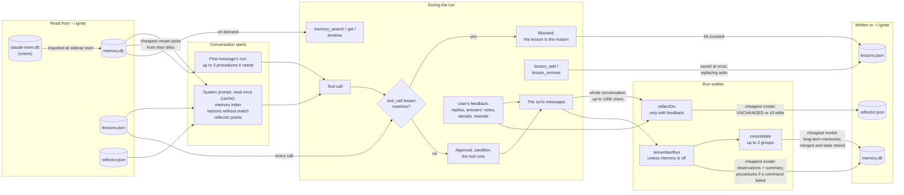
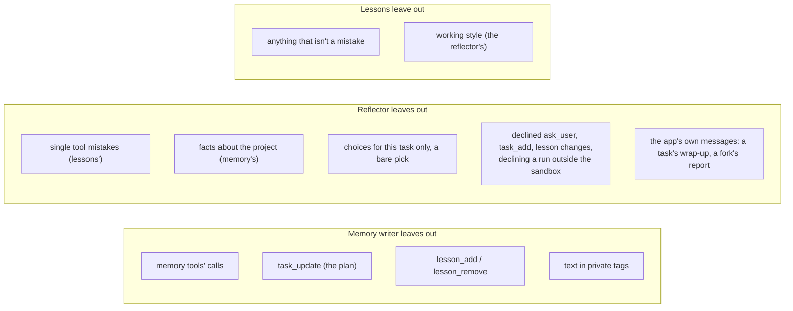

# How the agent learns: memory, lessons and the reflector

Three systems carry what one conversation learned into later ones. Each has
one job, and each leaves the others' jobs alone.

|                   | Memory                                                                                                                                                           | Lessons                                                                        | Reflector                                                                                                                                        |
| ----------------- | ---------------------------------------------------------------------------------------------------------------------------------------------------------------- | ------------------------------------------------------------------------------ | ------------------------------------------------------------------------------------------------------------------------------------------------ |
| Keeps             | What the work was: observations (bugfix, feature, decision…) and each run's summary; procedures, how a run got past a failed command                             | The agent's mistakes, so none repeats                                          | How this user wants the agent to work: report, ask, plan, deliver, delegate; each point with when it applies and the user's words that taught it |
| Written by        | The cheapest model of the conversation's provider, after every run                                                                                               | The agent itself, with `lesson_add`, the turn it's corrected                   | The cheapest model, after a run with the user's feedback                                                                                         |
| Stored in         | `~/.ignite/memory.db` (SQLite, FTS5), per folder                                                                                                                 | `~/.ignite/lessons.json`, every folder or one                                  | `~/.ignite/reflector.json`, every folder                                                                                                         |
| Read by the agent | An index in the system prompt; `memory_search`, `memory_get`, `memory_timeline`; up to 3 procedures the first message needs, as a hidden message joining its run | Listed in the system prompt; a `tool_call` lesson with `match` blocks the call | Each point beside its entry point's guidance in the system prompt, as "When …: point" when it has a `when`; never its evidence                   |
| Limits            | Index: 40 long-term memories (5,000 characters), then 50 observations, 10 summaries, 10,000 characters in all                                                    | 30 per scope                                                                   | 10 per entry point, 3 edits per reflection                                                                                                       |
| Subagents         | None                                                                                                                                                             | The same checks                                                                | None                                                                                                                                             |
| Code              | `hostMemory.ts`, `memoryWriter.ts`, `memoryConsolidate.ts`, `memoryContext.ts`, `memoryExtension.ts`, `procedures.ts`                                            | `lessonExtension.ts`, `lessons.ts`, `lessonRegex.ts`                           | `hostReflect.ts`, `reflector.ts`, `reflectorExtension.ts`                                                                                        |

## Through one conversation

Each file shows twice: on the left where it's read, on the right where it's
written.

The system prompt is read once per conversation, so what a run writes reaches
the next conversation, not the rest of this one. Lessons are the exception:
their `tool_call` checks read `lessons.json` on every call, so a lesson saved
mid-run blocks its mistake at once.

## What each leaves to the others

- **A mistake** the user corrects becomes a lesson, written by the agent in the
  same turn. The reflector skips it: one tool mistake teaches nothing about how
  the user wants the agent to work.
- **A working style** ("ask one decision per question") comes only from the
  user's own feedback, and only the reflector keeps it. Lessons never hold
  style, and the reflector never blocks a call.
- **What happened** (what was built, fixed or decided) goes to memory after
  every run, feedback or not. Neither lessons nor reflector points hold project
  facts.
- **How to get past a failed command** (a setup step, a command's right flags)
  is a procedure, recorded with memory only when a command in the run (bash,
  git or gh) exited non-zero (never a block, the sandbox's included, a denial,
  a refusal or a model's own judgement). The writer sees the folder's
  procedures, so it doesn't record one twice, and the lessons the run saved,
  since a mistake the user corrected is a lesson's. While a new conversation's first message is sent, never held up, the
  cheapest model picks the ones it needs, usually none; they join its run once
  it has started, offered, never enforced.
- **A pile of memories** about one file (or the procedures, or one topic of
  memories that name no file, found by their titles) is consolidated after a
  run once enough are new: merged into long-term memories, judged
  against the file now and its commits, the merged and the provably false ones
  retired, never deleted. Long-term memories lead the recalled index.
- Lesson calls are kept out of memory, and declined lesson changes out of the
  reflector's feedback, so one system's bookkeeping never teaches another.

## Where the user sees and edits them

- **Settings → Memory**: on or off (`[memory] enabled`, read before each run),
  the folder's memories searched and filtered by type.
- **Settings → Lessons**: on or off (`[lessons] enabled`); every lesson, where
  it applies and how often it came up; removes one.
- **Settings → Procedures**: on or off (`[procedures] enabled`, and only with
  memory on); every folder's procedures, their steps, the conversation each was
  learned in and when; removes one.
- **Settings → Reflector**: on or off (`[reflector] enabled`); every point, its
  entry point, when it applies and the words that taught it, what taught it
  and in which conversation; edits one in place (then the user's own) or
  removes it.

Off, each stops learning new ones and stops using what it has (no prompt
lines, no blocked calls, no offered procedures); what's saved stays listed, so
switching back on picks up where it left off.
